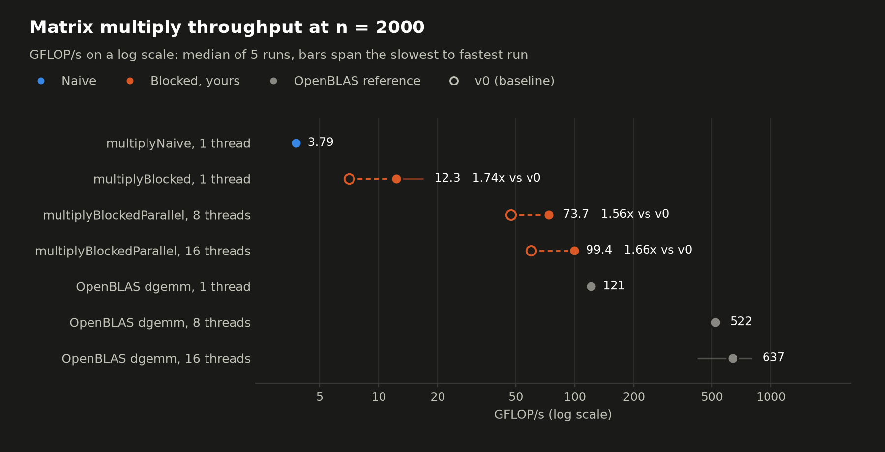
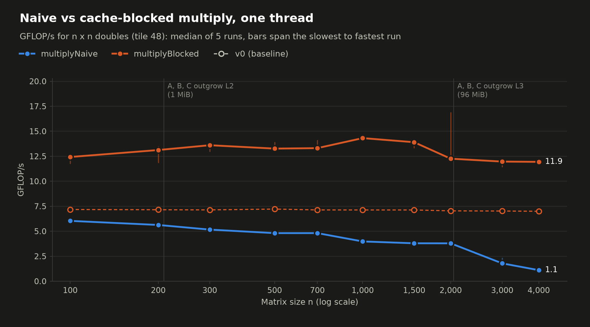
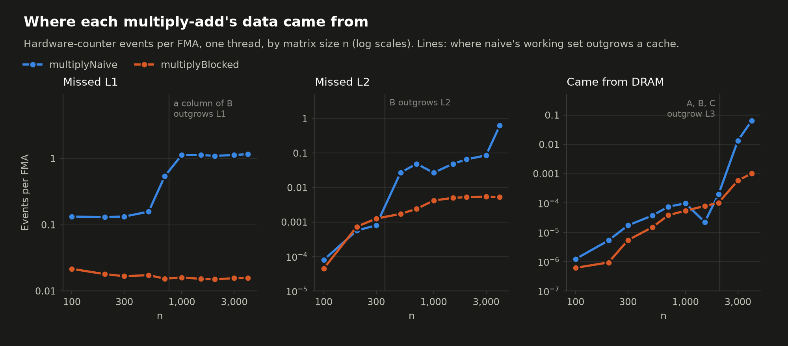
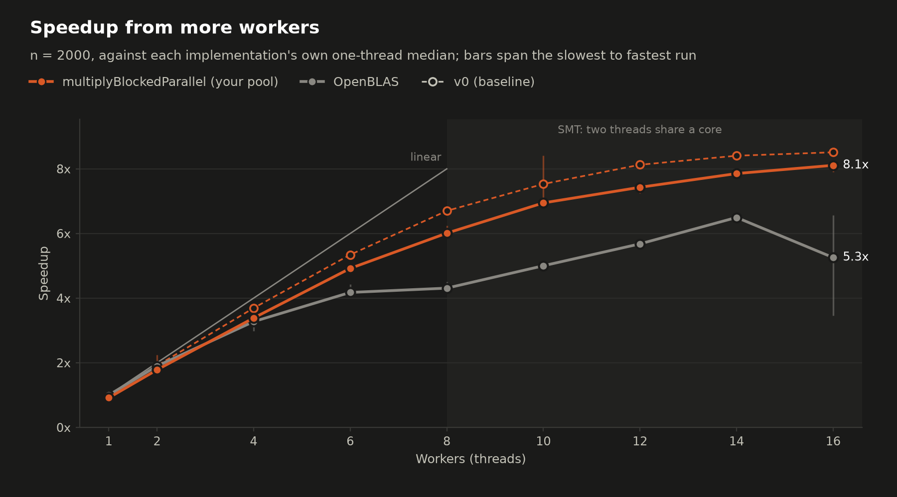
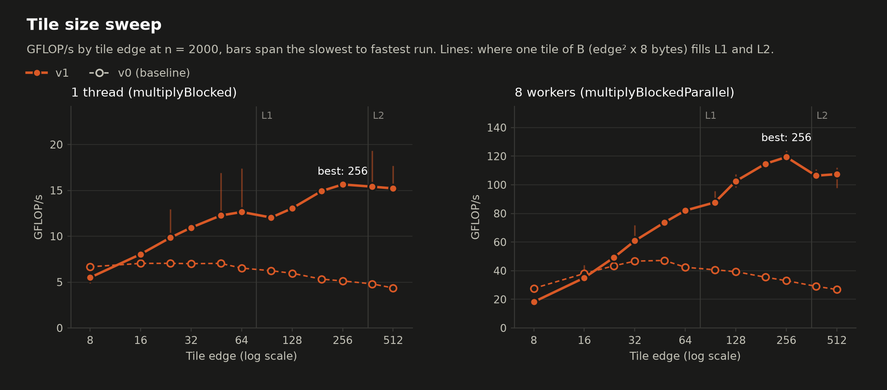

# Benchmark results: v1

- Machine: AMD Ryzen 7 9800X3D 8-Core Processor; 8 cores, 16 hardware threads; L1d 48 KiB and L2 1 MiB per core, L3 96 MiB shared by all 8 cores
- Build: gcc 13.3.0, `-std=c++17 -Wall -Wextra -Iinclude -pthread -O3 -march=native -g -falign-loops=64`, git v1
- Reference: OpenBLAS 0.3.26 NO_LAPACKE DYNAMIC_ARCH NO_AFFINITY Cooperlake MAX_THREADS=64 core=Cooperlake
- Run: 2026-10-24T17:31:44-07:00, median of 5 repetitions, wall-clock time, every result checked with Freivalds' algorithm
- Baseline: v0, run 2026-10-04T00:47:28-07:00. The charts draw its blocked kernels as hollow markers and dashed lines; "vs v0" columns are speedups over it.

## Headline: n = 2000, tile 48

| Implementation | Threads | Time (ms) | GFLOP/s | vs naive | vs v0 | vs OpenBLAS, same threads | CV |
|---|---:|---:|---:|---:|---:|---:|---:|
| multiplyNaive | 1 | 4,222 | 3.79 | 1x | - | 3.1% | 0.5% |
| multiplyBlocked | 1 | 1,305 | 12.3 | 3.23x | 1.74x | 10.1% | 17.3% |
| multiplyBlockedParallel | 8 | 217 | 73.7 | 19.4x | 1.56x | 14.1% | 2.5% |
| multiplyBlockedParallel | 16 | 161 | 99.4 | 26.2x | 1.66x | 15.6% | 1.5% |
| OpenBLAS dgemm | 1 | 132 | 121 | 32x | - | 100.0% | 0.7% |
| OpenBLAS dgemm | 8 | 30.7 | 522 | 138x | - | 100.0% | 2.4% |
| OpenBLAS dgemm | 16 | 25.1 | 637 | 168x | - | 100.0% | 29.9% |

## By matrix size, one thread

GFLOP/s, then hardware-counter events per multiply-add (N = naive, B = blocked).

| n | Naive | Blocked | Blocked / naive | Blocked vs v0 | OpenBLAS | L1D miss N | L1D miss B | L2 miss N | L2 miss B | DRAM fill N | DRAM fill B |
|---|---:|---:|---:|---:|---:|---:|---:|---:|---:|---:|---:|
| 100 | 6.04 | 12.4 | 2.06x | 1.73x | 138 | 0.132 | 0.0216 | 7.93e-05 | 4.44e-05 | 1.22e-06 | 6.16e-07 |
| 200 | 5.63 | 13.1 | 2.33x | 1.84x | 107 | 0.13 | 0.0179 | 0.000567 | 0.000734 | 5.3e-06 | 9.38e-07 |
| 300 | 5.16 | 13.6 | 2.63x | 1.91x | 109 | 0.133 | 0.0167 | 0.000802 | 0.00126 | 1.73e-05 | 5.41e-06 |
| 500 | 4.81 | 13.3 | 2.76x | 1.84x | 116 | 0.158 | 0.0173 | 0.0272 | 0.00172 | 3.72e-05 | 1.49e-05 |
| 700 | 4.81 | 13.3 | 2.77x | 1.87x | 116 | 0.54 | 0.0153 | 0.0491 | 0.00241 | 7.51e-05 | 3.85e-05 |
| 1000 | 3.98 | 14.3 | 3.60x | 2.01x | 118 | 1.13 | 0.016 | 0.027 | 0.00422 | 9.75e-05 | 5.47e-05 |
| 1500 | 3.8 | 13.9 | 3.66x | 1.95x | 119 | 1.13 | 0.0152 | 0.0491 | 0.00503 | 2.24e-05 | 7.89e-05 |
| 2000 | 3.79 | 12.3 | 3.23x | 1.74x | 121 | 1.09 | 0.015 | 0.0661 | 0.00531 | 0.000199 | 0.000102 |
| 3000 | 1.79 | 12 | 6.70x | 1.70x | 122 | 1.13 | 0.0156 | 0.0864 | 0.00545 | 0.0135 | 0.000589 |
| 4000 | 1.11 | 11.9 | 10.77x | 1.71x | 123 | 1.16 | 0.0157 | 0.635 | 0.00532 | 0.0636 | 0.00101 |

## Thread scaling: n = 2000, tile 48

Speedup is against single-threaded multiplyBlocked; efficiency divides it by the physical cores in use (at most 8). GHz is the average clock of the busy cores; IPC is per hardware thread.

| Workers | Time (ms) | GFLOP/s | vs v0 | Speedup | Efficiency | GHz | IPC | L1D miss/FMA | OpenBLAS GFLOP/s | OpenBLAS speedup |
|---|---:|---:|---:|---:|---:|---:|---:|---:|---:|---:|
| 1 | 1,426 | 11.2 | 1.57x | 0.915 | 92% | 5.06 | 2.22 | 0.0147 | 121 | 1 |
| 2 | 733 | 21.8 | 1.62x | 1.78 | 89% | 5.03 | 2.18 | 0.0207 | 230 | 1.9 |
| 4 | 386 | 41.5 | 1.60x | 3.39 | 85% | 5.09 | 2.04 | 0.0271 | 397 | 3.27 |
| 6 | 265 | 60.3 | 1.60x | 4.92 | 82% | 5.08 | 1.98 | 0.0315 | 506 | 4.18 |
| 8 | 217 | 73.7 | 1.56x | 6.01 | 75% | 5.03 | 1.83 | 0.0475 | 522 | 4.31 |
| 10 | 188 | 85.1 | 1.61x | 6.95 | 87% | 4.96 | 1.73 | 0.0624 | 606 | 5 |
| 12 | 176 | 91.1 | 1.59x | 7.43 | 93% | 4.98 | 1.54 | 0.0893 | 688 | 5.68 |
| 14 | 166 | 96.3 | 1.63x | 7.85 | 98% | 4.92 | 1.41 | 0.113 | 787 | 6.5 |
| 16 | 161 | 99.4 | 1.66x | 8.11 | 101% | 4.71 | 1.34 | 0.13 | 637 | 5.26 |

## Tile sweep: n = 2000

| Tile | 1 thread GFLOP/s | vs v0 | IPC | L1D miss/FMA | L2 miss/FMA | 8 workers GFLOP/s | vs v0 |
|---|---:|---:|---:|---:|---:|---:|---:|
| 8 | 5.49 | 0.82x | 4.78 | 0.0495 | 0.0154 | 18.2 | 0.66x |
| 16 | 8.04 | 1.14x | 3.73 | 0.0218 | 0.0106 | 35 | 0.92x |
| 24 | 9.83 | 1.40x | 3.29 | 0.0181 | 0.0105 | 49.2 | 1.13x |
| 32 | 10.9 | 1.56x | 2.95 | 0.0177 | 0.0083 | 60.9 | 1.30x |
| 48 | 12.3 | 1.74x | 2.52 | 0.015 | 0.00531 | 73.7 | 1.56x |
| 64 | 12.6 | 1.94x | 2.21 | 0.0539 | 0.00443 | 82 | 1.93x |
| 96 | 12 | 1.93x | 1.71 | 0.156 | 0.00335 | 87.7 | 2.16x |
| 128 | 13 | 2.19x | 1.67 | 0.149 | 0.00344 | 103 | 2.61x |
| 192 | 14.9 | 2.81x | 1.68 | 0.142 | 0.00489 | 115 | 3.23x |
| 256 | 15.6 | 3.05x | 1.6 | 0.138 | 0.0053 | 119 | 3.61x |
| 384 | 15.4 | 3.21x | 1.48 | 0.137 | 0.0356 | 106 | 3.66x |
| 512 | 15.2 | 3.49x | 1.38 | 0.138 | 0.0796 | 107 | 4.00x |
